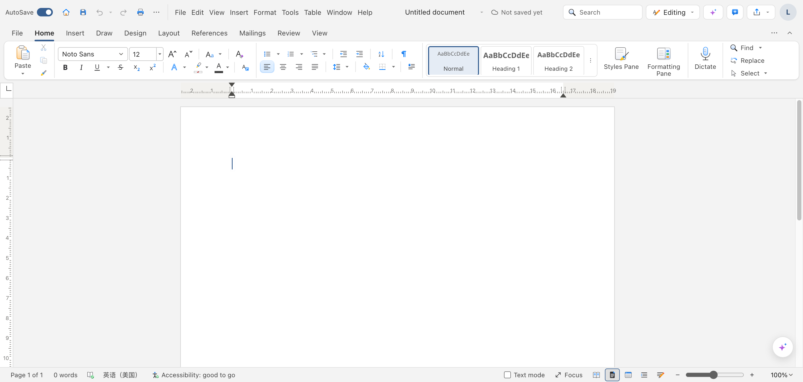
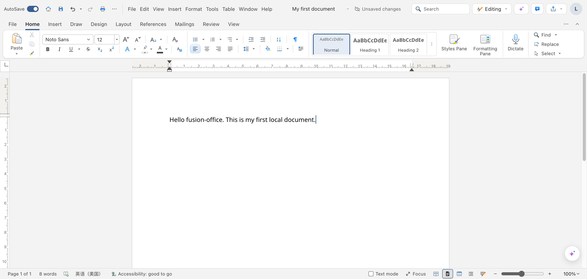

# Fusion Office 快速上手（Get Started）

> 目标：10 分钟内在 Documents（文字处理）里写出第一份文档并保存到本机。
> 界面文案以当前版本实机为准（截图自本机 11485 端口实测）。

## 1. 打开产品

- 入口：启动本地服务后在浏览器打开 `http://localhost:11485/`（Documents）。
  其余四个应用：Spreadsheet `11486`、Presentation `11487`、PDF `11488`、PM `11489`（以 `start.sh` 输出为准）。
- 无需登录：没有账号系统，数据只在本机。
- 第一屏你会看到：Word 风格的编辑器，标题为 "Untitled document"，左上角 "AutoSave" 开关，
  顶部菜单 File / Edit / View / Insert / Format / Tools / Table / Window / Help。

## 2. 认识工作区

- **快速访问工具栏**（左上角）：Save（Cmd+S）、Undo、Redo、Print。
- **功能区（Home 标签）**：字体、样式（Normal / Heading 1 / Heading 2 等）、对齐、列表。
- **编辑区（中间白页）**：直接打字。
- **状态栏（底部）**：页数（"Page 1 of 1"）、字数（"0 words"）、保存状态（"Not saved yet"）。

只讲第一件任务会碰到的区域，其余不讲。

## 3. 第一件任务：写一份文档并存到本机

每步三要素：做什么 → 怎么做 → 你会看到什么。

1. **改标题**：点击顶部 "Untitled document"，输入 `My first document`。
   你会看到：标题变成 "My first document"，旁边出现 "Unsaved changes"。
2. **输入正文**：点击中间白页，输入一句话。
   你会看到：文字出现在页面上，底部字数从 "0 words" 变为实际字数（截图中为 "8 words"）。
3. **保存**：点击左上角 "Save"（快捷键 Cmd+S）。
   你会看到：浏览器弹出保存位置选择框（系统级对话框，各浏览器样式不同）——选一个本机文件夹确认。
   保存后顶部 "Unsaved changes" 消失。文件以 `.docx` 兼容格式存进你选的文件夹。

完成：你手里有一份存在本机文件夹的 `.docx` 文档，可被 Word / WPS 打开。

## 4. 数据与隐私

- 数据存哪：你选的本机文件夹（File System Access API），或浏览器私有文件系统（OPFS）。
- 会不会离开本机：文档内容不出本机。只有你主动使用 AI 助手（右侧 "Assistant" 按钮）时，
  当前请求会发往本机的 fusion-gateway 并按其模型策略处理；不用 AI 就没有任何网络请求。

## 5. 下一步与帮助

- 五个应用总览（Word/表格/幻灯片/PDF/项目管理）：[README](../README.md)
- AI 助手与模型策略：[README](../README.md) 的 AI Client 一节
- 遇到问题：[troubleshooting](troubleshooting.md) · 反馈：https://github.com/dahai80/fusion-office/issues

## 提交检查清单

- [x] 每个按钮/菜单名与当前界面逐字一致（本机 11485 实测 + a11y 树核对）
- [x] 关键步骤有截图（原生保存对话框属浏览器 UI，无法页面截图，已用文字描述）
- [x] 第一任务 3 步且本机走通
- [x] data 段如实写了数据去向（含 AI 请求这一例外）
- [x] zh/en 成对（界面为英文界面截图）
- [x] 全篇 ≤ 100 行（不含图片引用）
